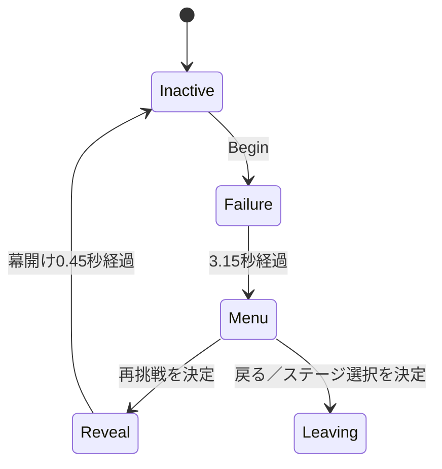

# SR1 01_03 State Pattern

確認日：2026年11月25日。作業ブランチ：`RS1_01_03`。
最終検証：2026年11月26日。
講義の「状態クラス自身が次の状態を決める」という条件に合わせ、失敗・再挑戦、シーンフェード、インベントリの3系統へ適用した。

## 1. ポリモーフィズム課題との違い

前回のParticleMotionやStageCellBehaviorは、種類に応じた振る舞いを共通の更新口から呼ぶStrategy型の設計だった。
今回は、現在の状態が入力・時間を処理し、次の状態を選ぶ**State Pattern**として実装した。
enumを増やしただけの状態管理ではなく、状態オブジェクトが共通の仮想関数をoverrideし、本体が基底参照から呼んでいる。

| 用語 | 今回の意味 |
|---|---|
| Context（状態を持つ本体） | 各Flow。現在状態と、時刻・座標・選択などのデータを所有する |
| State（状態の基底） | 共通の`Handle`と、状態識別用の`Kind`、virtualデストラクタを持つ |
| Concrete State（具体的な状態） | FailureState、OpeningStateなど。受け付ける操作と遷移先を実装する |
| Event（入力） | Advance、Confirm、Toggle、Resetなどの意味を持つ操作 |

## 2. 失敗演出と再挑戦：5状態

実装は[GameOverTimeline.h](C:/Users/shigo/Documents/ChatGPT/学校/CG2_01/project/Game/Scene/GameOverTimeline.h)と[GameOverTimeline.cpp](C:/Users/shigo/Documents/ChatGPT/学校/CG2_01/project/Game/Scene/GameOverTimeline.cpp)の`GameOverTimeline::Flow`。
以前はPhaseをif文で比較しながらAdvanceやConfirmの処理を分けていた。
今回、選択待ちも独立した状態にし、入力できる段階を明示した。



| 状態クラス | 受け付ける処理と遷移 |
|---|---|
| InactiveState | 停止中。Beginで失敗演出へ進む |
| FailureState | 失敗の時間を進め、3.15秒でMenuへ進む。途中の選択・決定は無視 |
| MenuState | 選択移動と決定を受け付ける。再挑戦ならReveal、戻るならLeavingへ進む |
| RevealState | 再挑戦の幕を開き、0.45秒でInactiveへ戻る。二重決定は無視 |
| LeavingState | シーン退出待ち。決定済みの操作を繰り返し実行しない |

外側のゲームは`flow.Advance(delta)`や`flow.Confirm(back)`を呼ぶ。
Flowは`Current().Handle(*this, event)`で、現在の状態へ処理を渡す。
例えばMenuStateが再挑戦を受け付けると、状態のHandle内から`flow.Change(Phase::Reveal)`を呼び、`Action::Retry`を返す。
RevealStateが終了時刻を判断して、Inactiveへ戻す。

Begin・Cancelの共通処理はFlow内部のヘルパーへまとめ、各状態から呼ぶ。
外部には任意のPhaseを書き込むsetterを公開していない。
Beginは時刻・選択を初期化し、どの状態からでも新しい失敗演出を開始できる。

実際の接続先は[GameOver.cpp](C:/Users/shigo/Documents/ChatGPT/学校/CG2_01/project/Game/Scene/GameOver.cpp)。
返されたRetryを[GameRuntimeScenes.cpp](C:/Users/shigo/Documents/ChatGPT/学校/CG2_01/project/Game/Scene/GameRuntimeScenes.cpp)が受けて、プレイヤーをリスポーンさせる。
Stateは描画・音声・プレイヤー全体を所有せず、遷移の規則を担当する。
落下座標の計算式と、敵接触用のヒットストップは従来のEvaluatePoseへ残している。

## 3. シーンフェード：4状態

新しい[SceneFadeFlow.h](C:/Users/shigo/Documents/ChatGPT/学校/CG2_01/project/Game/Scene/SceneFadeFlow.h)／[SceneFadeFlow.cpp](C:/Users/shigo/Documents/ChatGPT/学校/CG2_01/project/Game/Scene/SceneFadeFlow.cpp)へ分離した。

| 表示上のPhase | 状態クラス | 次の状態を決める条件 |
|---|---|---|
| None | IdleState | Beginを受けたらClosingへ |
| FadingOut | ClosingState | 透明度が1になったらCoveredへ |
| HoldingBlack | CoveredState | 黒画面の保持0.12秒が終わったらOpeningへ |
| FadingIn | OpeningState | 透明度が0になったらIdleへ |

通常フェードは従来と同じ速度3.0、回転幕付きは閉じる約0.55秒・開く約0.65秒。
一フレームに一状態だけ進め、時間の余りで黒画面保持を飛ばさない。
新しいシーンを完全な黒の裏で初回更新・描画する時間を残す。

ClosingStateは黒へ到達したフレームだけ読込通知を立てる。
`SceneFadeFlow::Advance`がその結果を返し、GameRuntimeが次の処理を行う。

```cpp
if (sceneFade_.Advance(deltaTime)) {
    sceneManager_->ChangeScene(pendingSceneType_, *this);
}
```

実際のコードにはSceneManagerがない場合の既存の分岐もある。
状態側は「いつシーンを切り替えられるか」、GameRuntimeは「どのシーンを読み込むか」を担当する。
進行中のBeginは無視し、二重のシーン予約で幕の向きや速度を変えない。
Resetは検証用の初期化や取消にも使い、透明度を含めて停止状態へ戻す。

既存コードの`sceneFadePhase_`と`sceneFadeAlpha_`の直接操作を、`CurrentPhase()`・`Alpha()`・`Reset()`へ置き換えた。
描画側は状態を問い合わせるだけで、遷移先を勝手に書き換えない。

## 4. インベントリの開閉：4状態

新しい[InventoryPanelFlow.h](C:/Users/shigo/Documents/ChatGPT/学校/CG2_01/project/Game/UI/InventoryPanelFlow.h)／[InventoryPanelFlow.cpp](C:/Users/shigo/Documents/ChatGPT/学校/CG2_01/project/Game/UI/InventoryPanelFlow.cpp)へ分離した。

| 状態クラス | 通常の進行 | Toggleを受けたとき |
|---|---|---|
| ClosedState | 閉じたまま | Openingへ |
| OpeningState | 開く座標へ近づき、到達したらOpenedへ | 現在座標のままClosingへ |
| OpenedState | 開いたまま | Closingへ |
| ClosingState | 閉じる座標へ近づき、到達したらClosedへ | 現在座標のままOpeningへ |

補間率0.15、到着判定1ピクセル未満は既存の値を維持した。
途中で開閉を反転しても位置を初期化しないため、座標が飛ばない。
ステージ開始・直接選択ではCloseを使って、どの状態からでも即座に閉じる。
Configureは不正な座標を受け付けず、以前の状態を保つ。

[BlockInventoryUI.cpp](C:/Users/shigo/Documents/ChatGPT/学校/CG2_01/project/Game/UI/BlockInventoryUI.cpp)は`panelFlow_.Advance()`と`panelFlow_.Toggle()`を呼び、結果のX座標をSpriteへ反映する。
在庫・選択・クリック判定・配置要求はUIと既存Controllerへ残す。
Flowの外に、OpeningからOpenedへ切り替える条件分岐は残していない。

## 5. 講義の4条件との対応

| 確認点 | 今回の対応 |
|---|---|
| 状態を表すクラスがある | 失敗系5、フェード4、インベントリ4の合計13状態 |
| 共通関数をoverrideする | 各Stateが仮想HandleとKindをoverrideする |
| 本体がポリモーフィズムで呼ぶ | Flowが`const State&`経由でHandleを呼ぶ |
| 状態自身が次を決める | MenuState・RevealState・ClosingState等のHandle内からChangeを呼ぶ |

基底Stateにはvirtualデストラクタも用意した。
StateForのswitchは種類と不変オブジェクトの対応付けだけを担当し、時間や入力の遷移判定は各状態が担当する。
Phaseというenumは表示上の問い合わせと内部の状態選択に残すが、更新処理をenumの大きなswitchへ戻していない。

## 6. カプセル化・所有・性能

- 各StateはFlowのprivateな入れ子クラス。外部に時刻・座標・現在状態の可変参照を公開しない。
- 入れ子クラスから所有元へアクセスする設計で、friendやprotectedなデータを追加していない。
- 状態オブジェクトはconstで共有し、時刻・選択・座標はFlowのインスタンスごとに保持する。
- コピーしたFlowを別々に進めても、共有State内に進行データがないため状態が混ざらない。
- 状態切替でnew/deleteを行わない。Handle実行中に状態が切り替わっても、実行中のStateは破棄されない。
- インベントリの補間は従来のフレーム基準を維持。今回FPS非依存化したという変更ではない。
- 仮想呼び出しが増えるため、FPSが向上したという主張はしていない。

## 7. そのまま残した処理と理由

| 対象 | 判断 |
|---|---|
| BGMの停止／ゲーム曲再生 | 2状態の単純な切替。Stateクラスを増やさず、既存の所有Controllerで管理する |
| プレイヤーの接地／空中／梯子 | 現在は3系統で、衝突結果を毎フレーム反映する処理。今回独立したState階層へ分割せず、既存の移動・梯子ヘルパーを使う |
| AnimationState | 物理・入力から毎フレーム導く再生クリップと速度の選択。独立したゲーム進行の状態機械を二重に持たせない |
| 開始演出、手帳打刻のタイムライン | 単発の演出を時刻から評価する方式。曲線やイベント境界を計算する関数をそのまま使う |
| 手帳の開閉 | 2方向の補間と途中反転。単純な目標角度と経過時間を保持する既存のInspectionを使う |
| 敵の追尾／帰還、崩れる床 | 2〜3段階の単純なセル更新。前課題のStageCellBehavior内で完結する。攻撃・待機など行動段階が増えたら改めてState化を検討する |
| AppModeとSceneType | 既存のシーン識別・描画条件のデータ。BaseScene／SceneManagerのシーンオブジェクトと重複するState階層を作らない |

既存のシーン管理は状態オブジェクトで更新を振り分ける構成を持つが、ゲーム内の遷移判断の一部はGameRuntimeにもある。
今回の3系統は、状態内部での遷移判断を明示できる題材として適用した。
プロジェクトのすべてのbool・enumを状態クラスへ置き換えたという実装ではない。

## 8. 検証

[StatePatternChecks.h](C:/Users/shigo/Documents/ChatGPT/学校/CG2_01/project/Tests/StatePatternChecks.h)へ、実ゲームと同じ公開操作を使うCPUテストを追加した。

- 失敗中の入力無効、選択待ちへの遷移、再挑戦・退出の分岐、決定の重複防止、再開始・取消。
- フェードの単調な変化、黒到達時だけの読込通知、保持状態の通過、進行中の再予約拒否、コピーの独立性。
- インベントリの開閉完了、途中反転で座標が飛ばないこと、強制Close、不正な座標の拒否。
- 30・60・144FPS相当の時間刻みと、既存の失敗・再挑戦・到着・シーン管理の回帰テスト。

CPUテストと既存RecoveryTests、Release / Debug / Developmentのx64ビルドを通過。
4ステージ、43物理ケース、回収・配置・取消、再開時の初期化をネイティブ実行で確認した。
実際のフェードを経た到着検査では、291フレームの追跡と開始地点への着地が成立した。
再挑戦・インベントリ・ステージ開始の録画を作成し、道具袋と再挑戦後の表示も画像で確認した。
フェードの所要時間・黒画面保持時間は、通常／回転幕付きの両方で30・60・144FPS相当のCPUテストを通過。

追加の配置カメラ検査では、未初期化のInputと旧ドラッグ操作の前提が残っていて初回は不成立だった。
検査用Inputをウィンドウへ初期化し、現行の自由視点移動と静止クリックの条件へ直して全項目の成立を確認した。
このために本体カメラの操作仕様は変更していない。初回の結果も保存した。

スタイル検査は231ファイル、波括弧不足0、対象の処理コメント不足0。カプセル化の補助検査と`git diff --check`も通過。
各JSONのコピーと集計は`generated/sr1-state/verification-summary.json`へ保存した。
実機の自動入力・録画確認と、手動の通しプレイは分けて扱う。

## 説明用の文章

> 失敗と再挑戦、シーンフェード、インベントリの開閉へState Patternを適用しました。本体は現在のStateへイベントを渡し、状態クラスが入力や経過時間に応じて次の状態を決めます。例えば失敗中は決定を無視し、メニュー状態だけが再挑戦を受け付けます。フェードでは黒画面に到達した状態から一度だけ読込を依頼し、初回描画を隠す保持状態へ進めます。Stateは不変で共有し、進行データは本体が所有するので、切替時の生成コストと状態の混線を避けています。
